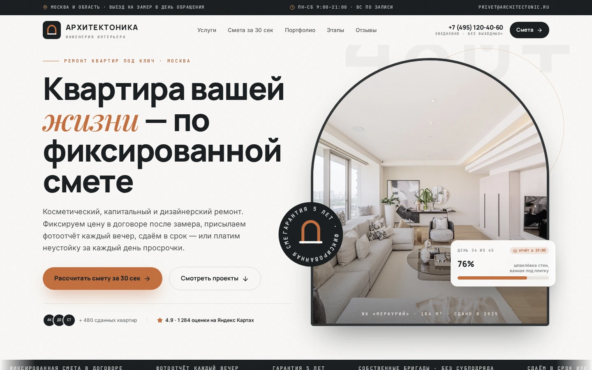

<div align="center">

# 🏛️ АРХИТЕКТОНИКА

### Ремонт квартир под ключ

Лендинг компании по ремонту квартир в Москве.<br>
Чистый фронтенд, без бэкенда: заявки сохраняются в `localStorage`, смета считается мгновенно.

<br>


[Скриншоты](#-скриншоты) · [Возможности](#-возможности) · [Запуск](#-быстрый-старт) · [Структура](#-структура-проекта)

</div>

---

## 📸 Скриншоты

Первый экран продакшн-сборки: десктоп (1440 × 900) и мобильная версия (390 × 844).
Нажмите на превью, чтобы открыть полностраничный снимок.

<div align="center">
  <a href="docs/screenshots/desktop-full.webp"></a>
  &nbsp;&nbsp;
  <a href="docs/screenshots/mobile-full.webp"></a>
</div>

<p align="center">
  <a href="docs/screenshots/desktop-full.webp">🖥️ Десктоп целиком</a> ·
  <a href="docs/screenshots/mobile-full.webp">📱 Мобильная версия целиком</a>
</p>

## ✨ Возможности

| Блок | Что умеет |
| --- | --- |
| 🧰 **Услуги** | Переключение по вкладкам |
| 🧮 **Калькулятор** | Интерактивная смета: предварительная стоимость считается мгновенно |
| 🖼️ **Портфолио** | Фильтры по категориям и лайтбокс для просмотра работ |
| 🪜 **Процесс и гарантии** | Как строится работа и что гарантирует компания |
| 💬 **Отзывы** | Автоматическая карусель |
| ❓ **FAQ** | Аккордеон с ответами на частые вопросы |
| 📨 **Форма заявки** | Маска телефона, валидация, сохранение в `localStorage` с имитацией отправки |

Калькулятор связан с формой: рассчитанная смета передаётся в заявку.

## 🧱 Стек

| Технология | Зачем |
| --- | --- |
| **React 19** | Интерфейс и компоненты |
| **Vite 7** | Сборка и dev-сервер |
| **Tailwind CSS 4** | Стили |
| **lucide-react** | Иконки |
| **vite-plugin-singlefile** | Вся сборка инлайнится в один `index.html` |

## 🚀 Быстрый старт

```bash
# установка зависимостей
npm ci

# dev-сервер
npm run dev
```

Откройте <http://localhost:5173>.

### Команды

| Команда | Что делает |
| --- | --- |
| `npm ci` | Устанавливает зависимости |
| `npm run dev` | Dev-сервер на `0.0.0.0:5173` |
| `npm run build` | Продакшн-сборка в `dist/index.html` (всё инлайнено в один файл) |
| `npm run preview` | Предпросмотр сборки на `0.0.0.0:4173` |

## 🗂️ Структура проекта

```text
.
├── docs/
│   └── screenshots/        # превью и полностраничные снимки для README
└── src/
    ├── App.tsx             # композиция страницы, связка калькулятор → форма
    ├── assets/             # оптимизированные фотографии интерьеров
    └── components/
        ├── Header
        ├── Hero
        ├── Services        # вкладки
        ├── Calculator      # интерактивная смета
        ├── Portfolio       # фильтры + лайтбокс
        ├── Process
        ├── Guarantees
        ├── Reviews         # автокарусель
        ├── Faq             # аккордеон
        ├── LeadForm        # маска телефона, валидация
        └── Footer
```

---

<div align="center">
  <sub>Сделано с ❤️ для тех, кто делает ремонт</sub>
</div>
